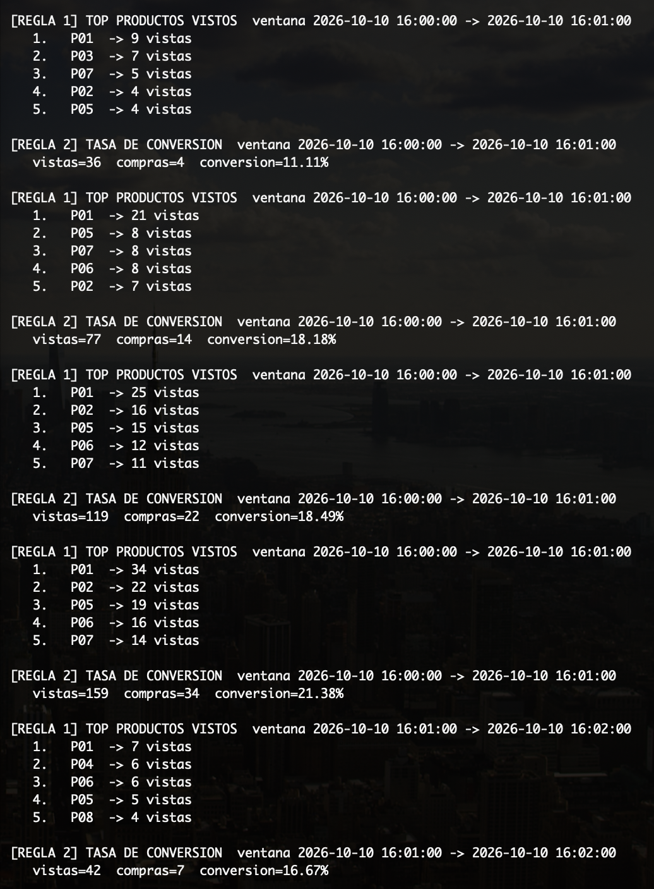
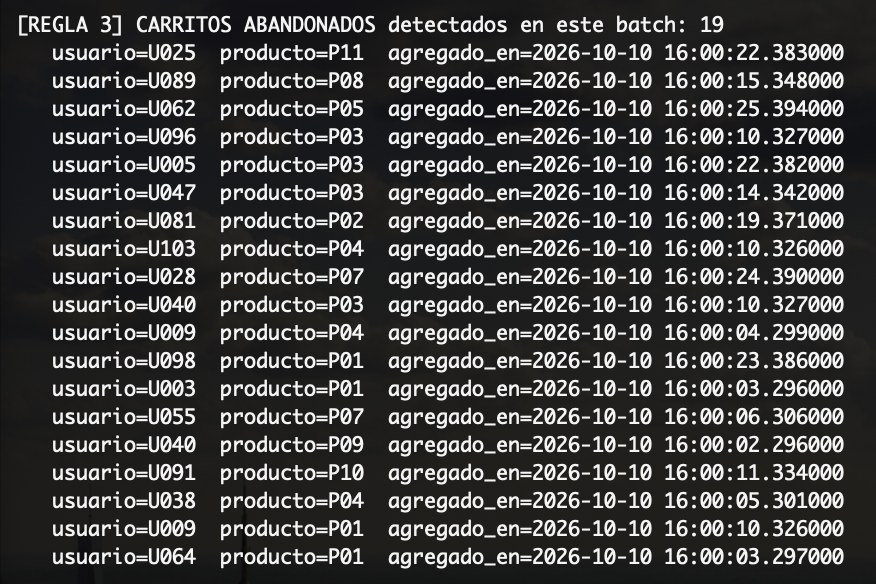
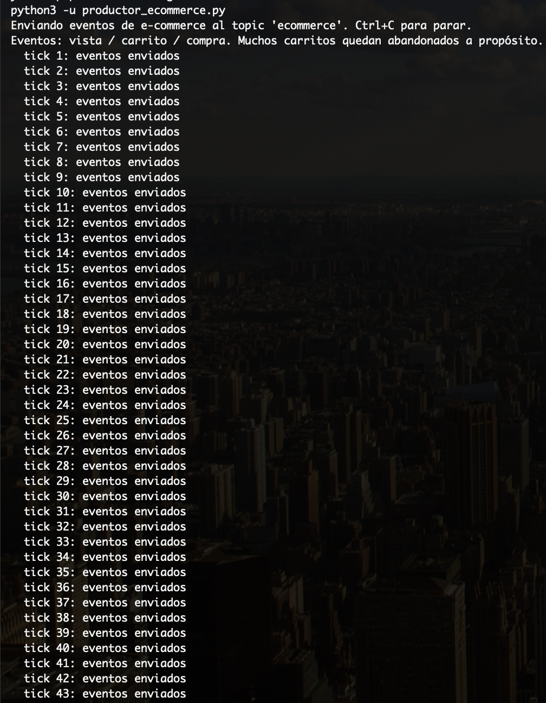
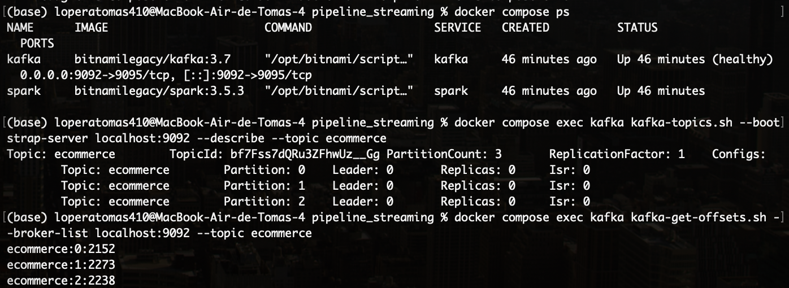

# Pipeline de Streaming en tiempo real

**Pareja:** Tomás Lopera y Pedro Sierra
**Caso elegido:** Caso B | Analítica de e-commerce en vivo (topic `ecommerce`)

Pipeline de streaming con **Kafka + Spark Structured Streaming** que detecta
en vivo 3 patrones de comportamiento de usuarios en una tienda online:
productos más vistos por ventana, tasa de conversión vista→compra, y
carritos abandonados.


## Cómo funciona el detector

El pipeline tiene tres piezas:

1. **Kafka** (Docker, modo KRaft, sin Zookeeper) con el topic `ecommerce` (3
   particiones), recibiendo eventos de `productor_ecommerce.py` sin
   modificarlo.
2. **Spark Structured Streaming** (contenedor Docker `bitnamilegacy/spark:3.5.3`),
   leyendo el topic con el conector `spark-sql-kafka-0-10`.
3. **`detector.py`**, que parsea cada evento JSON (`usuario`, `producto`,
   `tipo`, `precio`) y aplica las 3 reglas en paralelo (tres streaming
   queries corriendo sobre la misma sesión de Spark).

Como el evento no trae timestamp propio, se usa el timestamp de ingesta de
Kafka como *event time* para las ventanas y los watermarks.

Las tres reglas:

- **Regla 1 — Productos más vistos por ventana:** `groupBy(window(1 min),
  producto)` sobre eventos `tipo == "vista"`, y por cada ventana se imprime
  el top 5 vía `foreachBatch` (se necesita `foreachBatch` para poder hacer
  `orderBy().limit()` por ventana, que el modo streaming puro no permite).
- **Regla 2 — Tasa de conversión:** por ventana de 1 minuto, cuenta vistas y
  compras y calcula `compras / vistas * 100`.
- **Regla 3 — Carritos abandonados:** `LEFT OUTER JOIN` entre el stream de
  `carrito` y el stream de `compra` (mismo usuario + producto, compra dentro
  de 1 minuto después del carrito). Las filas donde no aparece una compra
  correspondiente son el carrito abandonado. Un join externo con streams
  requiere watermark en ambos lados y `outputMode("append")` — por eso el
  resultado aparece con un retraso de 1-3 minutos: Spark necesita esperar el
  watermark para estar seguro de que no va a llegar una compra tardía.

| Archivo | Qué es |
|---|---|
| `productor_ecommerce.py` | Productor Kafka del profesor (no modificar) |
| `docker-compose.yml` | Levanta Kafka (KRaft) + Spark en Docker |
| `detector.py` | El detector: las 3 reglas con Spark Structured Streaming |
| `run_detector.sh` | Lanza `spark-submit` dentro del contenedor `spark` |
| `requirements.txt` | Dependencia (`kafka-python`) para correr el productor en el host |

---

## Cómo correrlo

Kafka y Spark corren **ambos en Docker** (mismo host). El único proceso que
corre fuera de Docker es el productor (`productor_ecommerce.py`), porque
viene con `localhost:9092` fijo en el código y no se puede modificar — por
eso Kafka expone ese puerto al host.

### Requisitos
- Docker Desktop instalado y corriendo (`docker info` no debe dar error).
- Python 3 en el host con `pip install -r requirements.txt` (solo para el productor).

### 1. Levantar Kafka + Spark y crear el topic

```bash
docker compose up -d
```

Esto:
- Levanta `kafka` (modo KRaft, sin Zookeeper).
- Corre `kafka-init`, que crea el topic `ecommerce` (3 particiones) en cuanto Kafka esté sano, y lo describe por consola.
- Levanta `spark` (contenedor bitnami/spark, queda esperando con `tail -f /dev/null`).

Revisa que el topic quedó creado:

```bash
docker compose logs kafka-init
```

### 2. Instalar dependencias del productor

```bash
pip install -r requirements.txt
```

### 3. Arrancar el productor

```bash
python3 productor_ecommerce.py
```

Déjalo corriendo. Va a imprimir "tick N: eventos enviados" cada segundo.

### 4. Arrancar el detector

```bash
./run_detector.sh
```

La primera vez va a demorar un poco porque `spark-submit --packages` descarga
el conector `spark-sql-kafka-0-10` y sus dependencias (kafka-clients,
commons-pool2, etc.) dentro del contenedor.

Vas a ver en consola, intercalado:
- `[REGLA 1] TOP PRODUCTOS VISTOS` cada ventana de 1 minuto.
- `[REGLA 2] TASA DE CONVERSION` cada ventana de 1 minuto.
- `[REGLA 3] CARRITOS ABANDONADOS` cada ~30s, con un retraso natural de 1-3
  minutos (hay que esperar la ventana de watermark para estar seguros de que
  el carrito no se convirtió en compra).

### 5. Parar todo

```bash
# Ctrl+C en terminal 1 (productor) y terminal 2 (detector, o Ctrl+C dentro del exec)
docker compose down
```

### Troubleshooting rápido

- **`docker compose: unknown command`** → usa `docker-compose` (guion), el
  binario standalone (`docker-compose version`). `run_detector.sh` ya
  detecta esto solo.
- **El productor no conecta a `localhost:9092`** → confirma que
  `docker compose ps` muestra `kafka` como `healthy` y que el puerto `9092`
  está mapeado (`docker compose port kafka 9095` debe devolver `0.0.0.0:9092`).
- **`spark-submit` no encuentra el topic / timeout** → revisa que
  `kafka-init` terminó sin error (`docker compose logs kafka-init`) antes de
  lanzar el detector.
- **Las imágenes `bitnami/kafka` o `bitnami/spark` no se descargan** → ya no
  tienen tags públicos en Docker Hub; este repo usa `bitnamilegacy/kafka` y
  `bitnamilegacy/spark`, que sí son gratuitas.

---

## Resultados de cada regla

Corrida en vivo del 2026-10-10, con el productor y el detector corriendo
simultáneamente (ver evidencia más abajo).

### Regla 1 y Regla 2 — Productos más vistos y tasa de conversión

Ambas reglas corren sobre la misma ventana de 1 minuto y se ven intercaladas
en consola (modo `update`: el conteo de una ventana se va actualizando a
medida que llegan más eventos, por eso el mismo rango de ventana aparece
varias veces con números crecientes):

```
[REGLA 1] TOP PRODUCTOS VISTOS  ventana 2026-10-10 16:00:00 -> 2026-10-10 16:01:00
   1.   P01  -> 34 vistas
   2.   P02  -> 22 vistas
   3.   P05  -> 19 vistas
   4.   P06  -> 16 vistas
   5.   P07  -> 14 vistas

[REGLA 2] TASA DE CONVERSION  ventana 2026-10-10 16:00:00 -> 2026-10-10 16:01:00
   vistas=159  compras=34  conversion=21.38%

[REGLA 1] TOP PRODUCTOS VISTOS  ventana 2026-10-10 16:01:00 -> 2026-10-10 16:02:00
   1.   P01  -> 7 vistas
   2.   P04  -> 6 vistas
   3.   P06  -> 6 vistas
   4.   P05  -> 5 vistas
   5.   P08  -> 4 vistas

[REGLA 2] TASA DE CONVERSION  ventana 2026-10-10 16:01:00 -> 2026-10-10 16:02:00
   vistas=42  compras=7  conversion=16.67%
```

### Regla 3 — Carritos abandonados

```
[REGLA 3] CARRITOS ABANDONADOS detectados en este batch: 19
   usuario=U025  producto=P11  agregado_en=2026-10-10 16:00:22.383000
   usuario=U089  producto=P08  agregado_en=2026-10-10 16:00:15.348000
   usuario=U062  producto=P05  agregado_en=2026-10-10 16:00:25.394000
   usuario=U096  producto=P03  agregado_en=2026-10-10 16:00:10.327000
   usuario=U005  producto=P03  agregado_en=2026-10-10 16:00:22.382000
   usuario=U047  producto=P03  agregado_en=2026-10-10 16:00:14.342000
   usuario=U081  producto=P02  agregado_en=2026-10-10 16:00:19.371000
   usuario=U103  producto=P04  agregado_en=2026-10-10 16:00:10.326000
   usuario=U028  producto=P07  agregado_en=2026-10-10 16:00:24.390000
   usuario=U040  producto=P03  agregado_en=2026-10-10 16:00:10.327000
   usuario=U009  producto=P04  agregado_en=2026-10-10 16:00:04.299000
   usuario=U098  producto=P01  agregado_en=2026-10-10 16:00:23.386000
   usuario=U003  producto=P01  agregado_en=2026-10-10 16:00:03.296000
   usuario=U055  producto=P07  agregado_en=2026-10-10 16:00:06.306000
   usuario=U040  producto=P09  agregado_en=2026-10-10 16:00:02.296000
   usuario=U091  producto=P10  agregado_en=2026-10-10 16:00:11.334000
   usuario=U038  producto=P04  agregado_en=2026-10-10 16:00:05.301000
   usuario=U009  producto=P01  agregado_en=2026-10-10 16:00:10.326000
   usuario=U064  producto=P01  agregado_en=2026-10-10 16:00:03.297000
```

---

## Preguntas de negocio

**¿Cuál es el producto estrella?**

El producto **P01** aparece en el puesto 1 del ranking en la Regla 1 en la gran mayoría
de las ventanas observadas (seguido de cerca por P02), tanto en vistas como
en volumen dentro de las ventanas de conversión más altas.

**¿La tasa de conversión es sana?**

En la corrida se observaron tasas entre **11% y 28%** por ventana, con un
promedio cercano al **17-18%**. Es mucho más alta que el benchmark real de
e-commerce (2-5%), pero es un resultado esperado: el productor genera los
eventos con una distribución fija (~65% vistas, ~23% carritos, ~12%
compras), no con el comportamiento real de usuarios. Lo que sí valida la
regla es que el cálculo responde correctamente ventana a ventana — cuando
suben las vistas con pocas compras (ventana 16:04-16:05: 50 vistas / 4
compras) la conversión cae a 8%, y cuando compras y vistas crecen juntas se
mantiene estable alrededor del 17-22%.

**¿Cuántos carritos se abandonan y qué campaña propondrían para recuperarlos?**

En un solo batch de 30 segundos se detectaron **19 carritos abandonados**
(usuarios distintos, varios repitiendo con más de un producto abandonado,
como U009 y U040). Extrapolando, son decenas de carritos abandonados por
minuto. Propuesta de campaña: un recordatorio automático (push o email) a
los 2-3 minutos de agregar al carrito sin compra, con el producto que
quedó pendiente; para los productos que más se repiten en los abandonos
(P01, P03, P04 en nuestra muestra) un incentivo adicional — descuento del
10% o envío gratis — ya que son también los productos más vistos, así que
recuperar ese carrito tiene el mayor impacto en ingreso.

## Evidencia de ejecución en vivo

**Detector alertando — Reglas 1 y 2 (productos vistos y conversión):**



**Detector alertando — Regla 3 (carritos abandonados):**



**Productor enviando eventos al topic `ecommerce` (terminal paralela):**



**Contenedores de Docker arriba, topic creado con 3 particiones, y offsets
subiendo (evidencia de que Kafka está recibiendo mensajes reales):**


